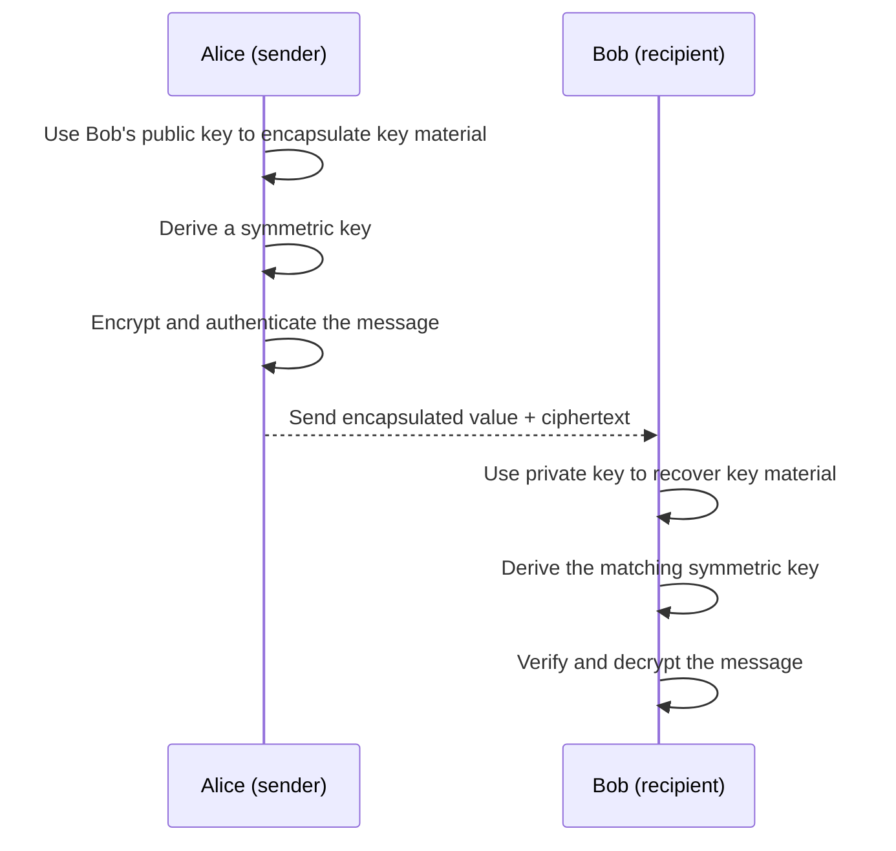

# How the two key models work together

Public-key techniques help with the key-sharing problem. Symmetric encryption then protects the message efficiently. This combination is called **hybrid encryption**.

Here is a simplified view of HPKE (Hybrid Public Key Encryption). It is a standardized construction described in [RFC 9180](https://www.rfc-editor.org/rfc/rfc9180).

The exact operations depend on the chosen standardized scheme. In HPKE, a key encapsulation mechanism (KEM) creates a shared secret and an encapsulated value; a key derivation function (KDF) derives key material; authenticated encryption with additional data (AEAD) protects the message. The recipient combines the encapsulated value with their private key to recover the same secret and decrypt.

## Why combine them?

- Public-key methods help establish key material without first sharing a long-term secret directly.
- Symmetric authenticated encryption is suited to protecting the actual data.
- Each step still has its own security requirements, including authenticating identities when the application needs to know who sent the message.

## One-sentence summary

**Public-key techniques help establish who can derive a secret; shared-key authenticated encryption uses derived key material to protect the message.**

This is a learning diagram, not a protocol specification. Use an established implementation of a protocol suited to your application rather than assembling these steps yourself.
