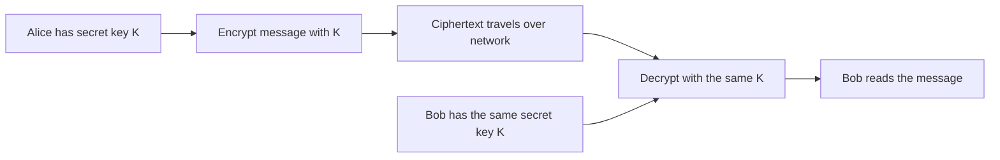

# Shared-key cryptography

A shared-key system uses the **same secret key** to encrypt and decrypt. Both people who need to communicate must have that key and keep it private.

## The useful part

Once both sides hold the key, symmetric encryption is efficient for protecting messages or files, including large amounts of data.

## The hard part

How do Alice and Bob get the same secret key safely? Sending it in an ordinary message lets an observer copy it. The key also needs careful storage and replacement if it is exposed.

## Encryption and tampering

Encryption aims to keep message contents private. A system also needs integrity protection so a receiver can detect a changed or forged message. Authenticated encryption combines these goals in one construction.

## Remember

- The key is secret and shared by every party that needs to decrypt.
- Anyone who obtains the key can generally read messages protected by it.
- Use an established authenticated-encryption scheme through a maintained library; do not invent a cipher or reuse a key/nonce in ways the scheme forbids.
